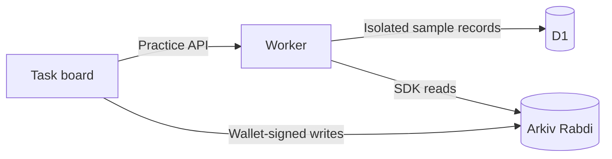

# Sidequest

**Find your missing piece.** A task board for builders: publish a focused ask, discover work by skill, claim it, and close the loop. Live tasks are wallet-owned Arkiv entities with a useful lifetime.

Built for ETHGlobal Mumbai. Target: **Arkiv — Build on Arkiv (from scratch)**.

## Features

- Responsive board with search, categories, status, expiry, sorting and grid/list views.
- Practice mode with session-isolated D1 storage and clearly labelled example tasks.
- Live Arkiv reads and browser-wallet-signed task, claim and completion records.
- Wallet setup, network switching, rejected-request handling and explorer links.
- Optional bounty offers. No escrow or payment processing.

## Run locally

Requires Node.js22.13 or newer.

```sh
npm ci
npm run build
node --import ./scripts/sites-env.mjs ./node_modules/wrangler/bin/wrangler.js d1 execute DB --local --config dist/server/wrangler.json --persist-to .wrangler/state --file drizzle/0000_unusual_calypso.sql
npm start
```

The required schema migration is included as SQL. The optional development-time migration generator is omitted from this public package.

Open the URL printed by the server, normally http://127.0.0.1:8787. After applying the local migration, `npm run dev` starts the editing preview against the same local database.

## Checks

```sh
npm run check:publication
npm test
npm run typecheck
npm run lint
npm run build
```

The publication check inspects staged Git content and rejects credential files, personal wallet literals, transaction identifiers and machine-specific paths. Enable the optional local pre-commit guard with `git config core.hooksPath .githooks`. Automated tests cover validation, task transitions, expiry, session isolation, concurrent claims and wallet error handling.

## Arkiv integration

- Current network: Rabdi, chain ID7794095, test gas token tGLM.
- [Official documentation](https://docs.arkiv.network/).
- [Test tokens](https://hub.arkiv.network/faucet) and [RPC access keys](https://hub.arkiv.network/access-keys).
- Public-edition schema: `sidequest.tasks.public.v1`.

This public edition uses a fresh schema namespace. Historical demonstration records, wallet details and their transaction links are deliberately excluded. No successful write to this new namespace is claimed. Connect your own test wallet and publish a task to create current evidence.

```ts
import { createPublicClient } from '@arkiv-network/sdk';
import { eq } from '@arkiv-network/sdk/query';
import { http } from 'viem';
import { arkivChain } from './lib/arkiv-config';
import { SidequestRecords } from './lib/arkiv-schema';
const client = createPublicClient({ chain: arkivChain(), transport: http() });
const result = await client.select({
  $key: true, $creator: true, $expiresAt: true,
  kind: true, category: true, payload: true,
}).from(SidequestRecords).where(eq('kind', 'task')).limit(100).fetch();
console.log(result.entities);
```

Use the Setup guide to connect a wallet, obtain test tokens, switch to Arkiv testnet and publish. A different wallet can claim the task; its original publisher or selected assignee can complete it. Self-claiming is rejected.

Optional server RPC credentials use `ARKIV_ACCESS_KEY`. `NEXT_PUBLIC_ARKIV_ACCESS_KEY` is browser-visible and must only contain a key intended for public clients. Never use a private service credential in a `NEXT_PUBLIC_` variable. With no keys configured, the app uses the rate-limited public RPC.

The optional `npm run arkiv:seed` command reads a test-only `ARKIV_PRIVATE_KEY` from the process environment. It is never read by application routes or browser code. Generated evidence stays in ignored `outputs/`; do not commit it without reviewing the addresses it contains.

## Architecture and limits

React/Vinext frontend, Cloudflare Worker API, D1 for practice sessions, official Arkiv SDK and viem for live records.



Live tasks and actions are readonly entities. Another wallet creates its own claim record instead of editing a publisher's entity. The reducer selects claims by creation block, then entity key. Completion authority follows the original publisher or selected assignee; transferring entity ownership externally does not transfer that publisher role.

This is an application coordination protocol, not an atomic reservation or escrow contract. Owners can delete their own entities, which can change the derived task state. The board reads at most2000 records. Practice workspaces allow100 active tasks per session. There is no global abuse quota, notification service, direct messaging or autonomous agent implementation.

## Privacy and publication

No local credentials, personal wallet evidence, screenshots, recordings, runtime databases or private deployment identity are included in this repository or its initial history. See [SECURITY.md](SECURITY.md).

Live blockchain use is public by design: addresses, transactions and posted task details are visible on the network. Do not put private information in a live task. Repository cleanup cannot remove an existing blockchain transaction.

Before a prize submission, collect current integration evidence and share it with judges as required by the track. This privacy-filtered source intentionally does not include a team's wallet address or proof transaction.

## License and AI disclosure

MIT. Built with OpenAI Codex assistance for ideation, implementation, visual design, documentation and testing. No adoption metrics or user-research results are claimed.
